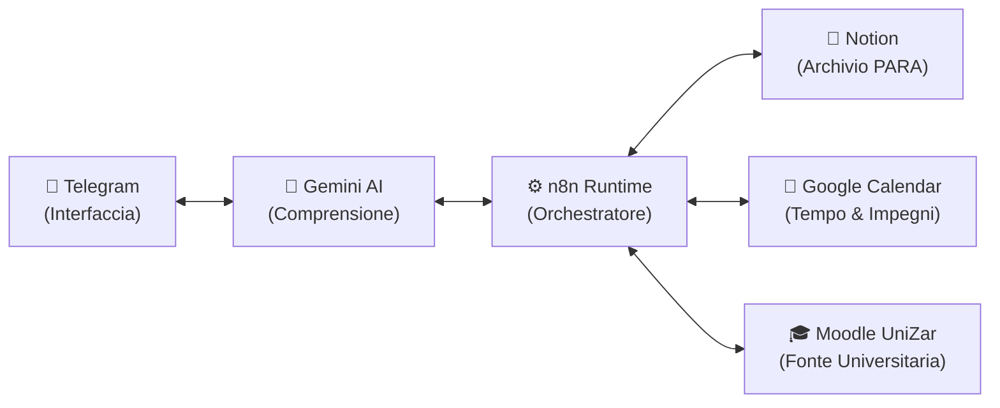

# 🏛️ Second Brain - Architettura Generale del Sistema

Questo documento descrive **come funziona il sistema nel suo complesso**, illustrando il ruolo di ciascuna componente e il modo in cui collaborano per creare un assistente personale autonomo, proattivo e sempre attivo.

---

## 🎯 1. Cos'è il Second Brain?

Il **Second Brain** è un sistema digitale progettato per estendere la memoria biologica e alleggerire il carico mentale quotidiano.  
Invece di dover ricordare scadenze universitarie, impegni di calendario, appunti sparsi o liste di cose da fare su diverse piattaforme, il Second Brain centralizza tutto in un unico punto di contatto accessibile ovunque: **una chat Telegram**.

Il sistema non si limita a memorizzare passivamente i dati, ma:
- **Comprende il linguaggio naturale:** non richiede comandi rigidi o sintassi complicate.
- **È proattivo:** ti invia ogni mattina il programma della giornata con bottoni rapidi per completare le attività.
- **È autonomo:** vigila costantemente sui portali universitari e aggiorna scadenze e calendari senza intervento manuale.
- **È sempre attivo:** risiede nel cloud ed è operativo 24 ore su 24, 7 giorni su 7, a costo zero.

---

## 🧩 2. Le Componenti Fondamentali

Il sistema è composto da **6 moduli principali**, ognuno con una responsabilità ben definita:

---

### 📱 A. L'Interfaccia Utente (Telegram)
Telegram funge da telecomando e da canale di comunicazione bidirezionale:
- **Accesso ovunque:** disponibile istantaneamente da smartphone, tablet o PC.
- **Multimodalità:** accetta messaggi di testo digitati al volo, note vocali registrate mentre si cammina o interazioni tramite tastiere a pulsanti.
- **Zero attrito:** per salvare un'idea o spostare una scadenza non serve aprire Notion o il calendario; basta scrivere una frase in chat come la si direbbe a un assistente umano.

---

### 🧠 B. Il Cervello Cognitivo (Google Gemini AI)
È il componente che trasforma il disordine del linguaggio umano in azioni precise e ordinate:
- **Comprensione dell'Intento (Semantic Routing):** analizza il messaggio in arrivo e ne capisce il vero significato, ignorando refusi di battitura (*"cosrso"*), sinonimi o modi di dire informali.
- **Distillazione e Sintesi:** quando riceve una nota lunga o un appunto disordinato, estrae i punti chiave essenziali e identifica se ci sono compiti pratici da svolgere.
- **Formulazione delle Risposte:** non risponde con messaggi robotici o tecnici, ma struttura risposte chiare, amichevoli, con emoji pertinenti e layout facili da leggere sullo schermo di un telefono.

---

### ⚙️ C. Il Motore di Esecuzione (n8n)
È il direttore d'orchestra che coordina tutti i flussi di informazione tra Telegram, l'AI e i database:
- **In ascolto continuo:** controlla regolarmente Telegram per rilevare nuovi messaggi o tap sui pulsanti.
- **Gestore del tempo (Cron Jobs):** fa scattare compiti a orari prestabiliti (es. la sveglia delle 08:30 per il briefing del mattino, o la sincronizzazione periodica ogni 2 ore).
- **Esecutore fidato:** riceve le istruzioni dall'AI ed effettua le chiamate appropriate ai database e alle API senza mai perdere dati.

---

### 📝 D. L'Archivio della Conoscenza (Notion & Metodo PARA)
Notion è il database centrale in cui risiede l'intera organizzazione personale, strutturato secondo la celebre metodologia **PARA**:
- **Inbox:** il raccoglitore temporaneo in cui confluiscono tutte le nuove note e pensieri appena catturati, pronti per essere consultati o elaborati.
- **Tasks (Attività):** il registro dei compiti da svolgere, ciascuno con la propria data di scadenza (*Due Date*), priorità e stato di avanzamento (*To Do*, *In progress*, *Done*, *Cancelled*).
- **Projects (Progetti):** raccoglitori di attività con un obiettivo concreto e una data di fine.
- **Areas (Aree di Responsabilità):** ambiti continuativi della vita (es. l'Università, le Finanze, la Salute).
- **Resources (Risorse):** materiali di studio, link utili, guide e appunti tematici archiviati per il futuro.

---

### 📅 E. La Gestione del Tempo (Google Calendar)
È il riferimento visivo per tutto ciò che è legato all'orario:
- **Orario Lezioni & Appuntamenti:** visualizza gli impegni fissi della giornata con orari di inizio e fine precisi e aula/luogo.
- **Codifica a Colori Automatica:** ogni materia accademica ha un colore dedicato riconosciuto a colpo d'occhio (es. Viola per Intelligenza Artificiale, Blu per Reti, Verde per Algoritmi).
- **Aggiunta al Volo:** se scrivi in chat *"fissa una call domani alle 15"*, l'evento compare direttamente in Google Calendar con data, ora e durata corrette.

---

### 🎓 F. La Sentinella Accademica (Moodle UniZar)
È il ponte verso l'università:
- Controlla a intervalli regolari la piattaforma Moodle per rilevare nuove consegne di progetti, laboratori o date di esami.
- Quando un professore pubblica una scadenza, il sistema la cattura in automatico, la inserisce tra i compiti di Notion e ne crea un promemoria sul calendario.

---

## 🔄 3. Come Funzionano i Flussi Principali

Ecco come i vari componenti collaborano nelle situazioni tipiche di ogni giorno:

### 1. Modifica o Annullamento di un Task
> **Esempio:** *"segna le task del corso di sistemi operativi come cancelled"* oppure *"imposta la scadenza per il 20 ottobre"*
1. Il messaggio arriva da Telegram a **n8n**.
2. **Gemini** comprende che si tratta di un'azione su un task, riconosce la materia (*Sistemi Operativi*) o la data richiesta (*20 ottobre*), e distingue se si vuole cambiare lo stato o solo la scadenza.
3. **n8n** interroga **Notion**, trova le attività corrispondenti e ne aggiorna le proprietà esatte (senza toccare gli altri campi).
4. Viene inviata una notifica di conferma all'utente su Telegram.

---

### 2. Cattura Rapida di una Nota o Idea
> **Esempio:** *"Idea: creare uno script per automatizzare i riassunti dei pdf"*
1. **Gemini** riconosce che il messaggio non è un comando o una domanda, ma una nuova informazione da custodire.
2. Viene generato un titolo sintetico e un sommario pulito.
3. Il contenuto viene archiviato ordinatamente nell'**Inbox di Notion**.
4. Telegram risponde confermando che l'idea è al sicuro nel Second Brain.

---

### 3. Il Briefing del Mattino (Morning Digest delle 08:30)
> **Esecuzione automatica programmata**
1. Alle **08:30**, n8n avvia il cron job mattutino.
2. Raccoglie in parallelo le lezioni e gli impegni da **Google Calendar** e le attività prioritarie da **Notion**.
3. **Gemini** impagina un briefing chiaro ed elegante con l'orario della giornata e le priorità da affrontare.
4. Sotto il messaggio vengono generati pulsanti rapidi interattivi: basta un tap sul cellulare per segnare un compito come completato.

---

### 4. Sincronizzazione Automatica Moodle
> **Esecuzione automatica ogni 2 ore**
1. Il sistema si collega al feed del calendario universitario di Moodle.
2. Se trova una nuova scadenza non ancora presente su Notion, la aggiunge con titolo, data limite e materia.
3. L'evento viene duplicato su Google Calendar con il colore ufficiale della materia.

---

## ☁️ 4. Infrastruttura: Sempre Attivo a Costo Zero

Tutto il sistema è progettato per essere completamente indipendente dal computer personale:

- **Esecuzione H24 su Google Cloud:** n8n risiede in un container Docker all'interno di una macchina virtuale gratuita permanente (*Always Free Tier* di Google Cloud). Anche spegnendo il computer, il Second Brain continua a ricevere messaggi, eseguire polling e sincronizzare Moodle.
- **Consumo Risorse Minimo:** Grazie a un'accurata ottimizzazione della memoria e all'eliminazione automatica delle esecuzioni storiche, l'intero sistema occupa meno di **100 MiB di RAM** e genera **0,00 € di costi**.
- **Doppio Ambiente Protetto:** Grazie allo strumento di gestione `./brain.sh`, è possibile sviluppare o testare modifiche sul proprio PC in locale senza interferire con l'assistente attivo nel Cloud. Quando le modifiche sono pronte, un singolo comando le trasferisce in produzione.
