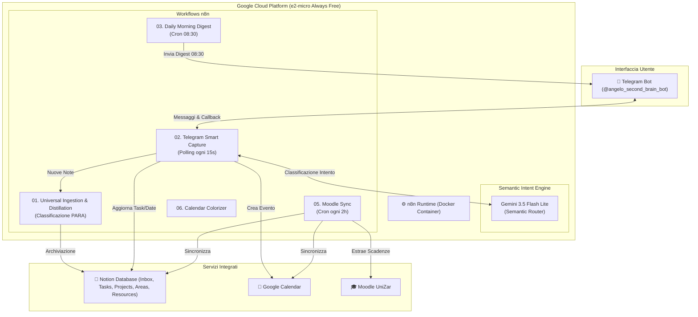
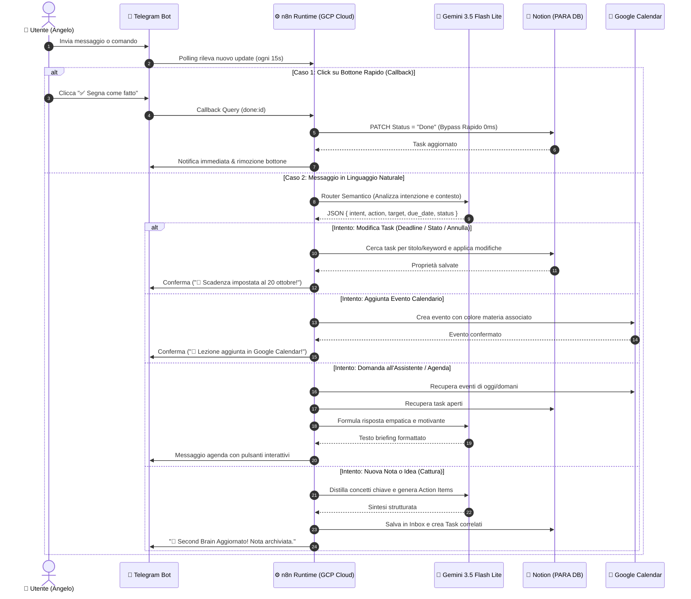

# 🧠 Second Brain - AI Personal Operating System

> **Sistema operativo personale autonomo basato su n8n, Google Gemini 3.5 Flash Lite, Notion PARA Method, Google Calendar e Telegram.**  
> Progettato per girare **H24 a Costo Zero (0,00 €)** nel tier *Always Free* di Google Cloud Platform (`e2-micro`, us-central1).

---

## 🌟 Visione & Funzionalità Principali

Il **Second Brain** agisce come un assistente esecutivo personale sempre attivo, accessibile ovunque tramite bot Telegram:

1. **Routing Semantico Intelligente (Gemini 3.5 Flash Lite):**
   - Abbandona le fragili espressioni regolari (regex): interpreta il linguaggio naturale, lo slang, i refusi e comandi multilingua (italiano/spagnolo/inglese).
   - Classifica istantaneamente l'intento dell'utente in 4 categorie: **Azioni sui Task**, **Eventi Calendario**, **Domande all'Assistente**, **Cattura Note / Inbox**.
2. **Gestione Task Avanzata (Notion PARA):**
   - **Completamento & Annullamento:** Chiude i task (`Done`) o li annulla (`Cancelled`) con supporto a singoli task o aggiornamenti di gruppo (es. *"segna le task di sistemi operativi come cancelled"*).
   - **Impostazione Scadenze (Deadlines):** Sposta o imposta la data di scadenza (`Due Date`) senza alterare lo stato (es. *"imposta a queste attività la deadline per il 20 ottobre"*).
   - **Tasti Rapidi Telegram:** Bottoni inline sotto il digest giornaliero per completare le attività con 1 tocco (latenza 0ms con bypass LLM).
3. **Sincronizzazione Universitaria Automatica (Moodle & GCal):**
   - Polling periodico su Moodle UniZar ogni 2 ore: estrae compiti, scadenze ed esami, sincronizzandoli su Notion e Google Calendar.
   - Color-coding automatico per materia su Google Calendar (es. Viola per IA, Blu per Reti, Verde per Algoritmi).
4. **Daily Morning Digest (Ore 08:30):**
   - Ogni mattina alle 08:30 (Europe/Rome) invia un briefing su Telegram con l'orario delle lezioni, gli eventi in agenda e i task prioritari da svolgere.
5. **Architettura Microkernel Orchestrata (`./brain.sh`):**
   - CLI modulare per sviluppare localmente, esportare e importare workflow da file JSON tracciabili su Git, e fare il deploy sul Cloud con 1 comando.

---

## 🏗️ Architettura di Sistema



---

## 🔁 Diagramma di Sequenza (Sequence Diagram)

Il diagramma seguente mostra il ciclo di vita di una richiesta, evidenziando il bypass a 0ms per i pulsanti inline e il routing semantico con Gemini per i messaggi naturali:



---

## 📂 Struttura del Progetto

```bash
Second_Brain/
├── brain.sh                     # 🎛️ Orchestratore Principale Microkernel (CLI & Menu)
├── kernel/                      # 🧩 Moduli del Microkernel
│   ├── common.sh                # Costanti, SSH multiplexing pooling, utility
│   ├── mod_dev.sh               # Pausa Cloud ➔ Avvia n8n locale su :5678
│   ├── mod_deploy.sh            # Checkpoint WAL ➔ Compressione ➔ Deploy GCP ➔ Riavvio
│   ├── mod_workflow_export.sh   # Dump da SQLite a workflows/*.json
│   ├── mod_workflow_import.sh   # Importa workflows/*.json con AUTO-PUBLISH nel DB
│   ├── mod_logs.sh              # Streaming log real-time (Cloud o Locale)
│   ├── mod_status.sh            # Diagnostica completa (RAM, Swap, CPU, Versioni attive)
│   └── mod_clean.sh             # Vacuum SQLite e pulizia log esecuzioni storiche
├── workflows/                   # 📄 Definizione Workflow in formato JSON
│   ├── 01_subworkflow_core_ingestion.json
│   ├── 02_telegram_capture_and_agent_polling.json
│   ├── 03_daily_digest_interactive_tasks.json
│   ├── 05_triggers_external_sources.json
│   └── 06_colorize_university_calendar_events.json
├── start_n8n.sh                 # 🚀 Script di avvio n8n con tuning per VPS e2-micro
├── .env                         # 🔐 Credenziali e ID database Notion (crittografato)
└── ARCHITECTURE.md              # 📖 Documentazione tecnica approfondita dell'architettura
```

---

## 🎛️ Guida all'Orchestratore (`./brain.sh`)

Il progetto include un microkernel con menu interattivo e supporto per comandi diretti da terminale:

```bash
# Avvia il menu interattivo:
./brain.sh

# Oppure esegui direttamente i comandi:
./brain.sh status    # Mostra utilizzo RAM, CPU, container e versioni pubblicate
./brain.sh logs      # Streaming in tempo reale dei log dal Cloud
./brain.sh dev       # Mette in pausa il Cloud e avvia n8n locale per modifiche via UI
./brain.sh export    # Esporta le modifiche grafiche dell'editor nei file JSON
./brain.sh import    # Importa i file JSON nel database locale con auto-publishing
./brain.sh deploy    # Comprime il DB, lo invia alla VPS e riavvia n8n in produzione
./brain.sh clean     # Ottimizza SQLite rimuovendo la cronologia di esecuzione
```

---

## 🔄 Flusso di Lavoro (Workflow Development Cycle)

Per modificare o creare nuove automazioni in modo pulito e senza conflitti:

1. **Passa in modalità Sviluppo Locale:**
   ```bash
   ./brain.sh dev
   ```
   *Questo mette in pausa il Cloud e avvia n8n su `http://localhost:5678`.*
2. **Modifica i workflow via browser:**
   Apri `http://localhost:5678` e fai le tue modifiche graficamente.
3. **Esporta le modifiche nei file JSON:**
   ```bash
   ./brain.sh export
   ```
4. **Fai il Deploy in Produzione sul Cloud:**
   ```bash
   ./brain.sh deploy
   ```
   *Il database viene ottimizzato (2-3 MB), trasferito via SCP sicuro, il container cloud viene riavviato e n8n locale viene spento per cedere il polling a GCP.*

---

## 💬 Esempi di Comandi Telegram Riconosciuti

Grazie al **Gemini Semantic Router**, il bot comprende qualsiasi formulazione naturale:

| Azione Desiderata | Cosa puoi scrivere su Telegram |
| :--- | :--- |
| **Completare un task** | *"completa 1"*, *"fatto 2"*, *"segna come completata la consegna di reti"* |
| **Annullare/Cancellare task** | *"segna le task del corso di sistemi operativi come cancelled"*, *"annulla il task 3"* |
| **Impostare Deadline / Scadenza** | *"imposta a queste attività la deadline per il 20 ottobre"*, *"sposta la scadenza di algoritmia a venerdì"* |
| **Aggiungere Evento a Calendario** | *"aggiungi lezione di reti domani dalle 9 alle 11 in aula 1.02"*, *"ricordami di andare dal dentista lunedì alle 15"* |
| **Consultare Agenda e Impegni** | *"cosa ho da fare oggi?"*, *"mostrami le task"*, *"che lezioni ho domani?"* |
| **Cattura Rapida Note / Idee** | *"comprare cavo HDMI"*, *"idea: nuovo script di backup per sqlite"* |

---

## ⚙️ Specifiche e Ottimizzazioni per GCP Always Free

La VPS di produzione gira su Google Cloud `e2-micro` (1 GB RAM, 1 vCPU, 2 GB Swap). Per garantire stabilità 24/7 a costo 0,00 €:
- **Pruning Automatico:** `EXECUTIONS_DATA_PRUNE=true`, `EXECUTIONS_DATA_MAX_AGE=12` (rimuove esecuzioni vecchie ogni 12h).
- **Zero Memory Leaks:** Modulo MCP legacy disabilitato (`N8N_DISABLED_MODULES=mcp`) per evitare background polling orfani.
- **Task Runner Concurrency:** `N8N_RUNNERS_GRANT_TOKEN_TTL=300` e `N8N_RUNNERS_TASK_TIMEOUT=120` per prevenire timeout al boot su CPU condivise.
- **Utilizzo RAM Effettivo:** **~97 MiB** (meno del 10% della memoria disponibile).

---

## 📄 Licenza & Privacy

Progetto personale per l'automazione della produttività e dell'attività accademica di Angelo.  
Tutte le API Key e i token sono gestiti tramite variabili di ambiente in `.env` e non vengono esposti.
